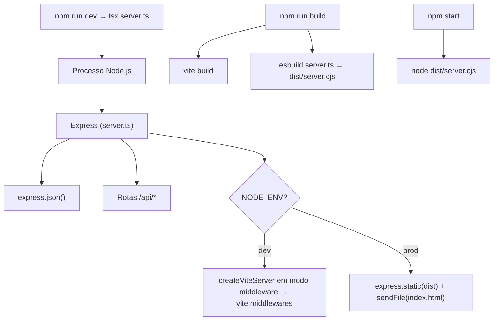
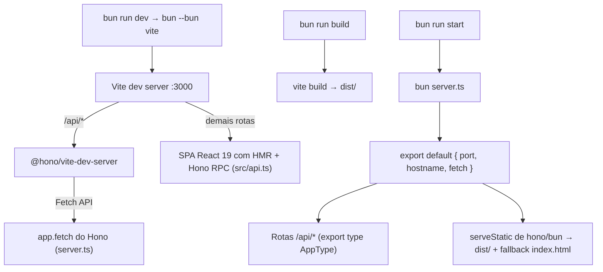

# Relatório de Refatoração Arquitetural — Synapse

| Campo | Valor |
| :--- | :--- |
| **Commit** | `9a8e6461df407b293a01c8b5bb0f6a6db0bd0115` |
| **Título** | `refactor: modernizes stack` |
| **Data** | 16/10/2026 |
| **Escopo** | 17 arquivos alterados, +136 / −6.075 linhas (5.551 delas são o `package-lock.json` removido) |

---

## 1. Resumo

O commit troca a camada de servidor, o runtime e a forma como o ambiente de desenvolvimento é montado. A lógica pedagógica (prompts, contratos de API, fallbacks, algoritmo SM-2, persistência em `localStorage`) **não mudou**.

| Antes | Depois | O que muda na prática |
| :--- | :--- | :--- |
| Express 4 + `@types/express` | **Hono + Hono RPC** | Rotas encadeadas usam `Request`/`Response` da Web e exportam `AppType` para o cliente `hc<AppType>('/')`. |
| `fetch('/api/...', ...)` manual | **`hc<AppType>('/')` (`src/api.ts`)** | Chamadas RPC tipadas de ponta a ponta entre servidor e React sem dependências extras. |
| Node.js como runtime | **Bun** | `server.ts` roda direto, sem compilar. |
| `tsx` (dev) | Bun | Bun executa TypeScript nativamente. |
| `esbuild` gerando `dist/server.cjs` | Nada | Produção roda `bun server.ts` direto. |
| npm + `package-lock.json` | Bun + `bun.lock` | Um único gerenciador de pacotes. |
| `dotenv` | Bun | Bun carrega o `.env` sozinho. |
| `createViteServer` + `vite.middlewares` dentro do `server.ts` | **Vite + `@hono/vite-dev-server`** | O Vite comanda o dev server e repassa `/api/*` ao Hono. |

---

## 2. Arquitetura antes e depois

### 2.1 Antes



O `server.ts` fazia tudo: definia a API, decidia entre dev e prod e subia o Vite por dentro como middleware do Express.

### 2.2 Depois



Agora o `server.ts` só exporta uma aplicação Hono e o tipo `AppType` das rotas encadeadas. Quem decide como ela é servida é o ambiente:
- **Dev**: o Vite carrega o `server.ts` e manda as requisições `/api/*` para ele.
- **Prod**: o Bun lê o `export default { port, hostname, fetch }` e sobe o servidor HTTP.

---

## 3. Mudanças por arquivo

### 3.1 `server.ts` & `src/api.ts`

#### a) Express → Hono + Hono RPC

| Express | Hono + Hono RPC |
| :--- | :--- |
| `const app = express()` | `const app = new Hono()` com rotas encadeadas em `const routes = app.get(...).post(...)` |
| `app.use(express.json())` | `jsonBody<T>()` com `validator('json', ...)` de `hono/validator` |
| `(req: Request, res: Response) => {...}` | `async (c) => {...}` |
| `req.body` | `c.req.valid('json')` tipado estaticamente |
| `res.json(obj)` | `return c.json(obj, 200)` |
| `res.status(400).json(obj)` | `return c.json(obj, 400)` |
| `fetch('/api/...', { method: 'POST', ... })` | `api.api['...'].$post({ json: ... })` via `hc<AppType>('/')` em `src/api.ts` |

As cinco rotas (`/api/health`, `/api/chat`, `/api/feynman-evaluate`, `/api/generate-retrieval-deck`, `/api/generate-concept-breakdown`) são encadeadas para que `export type AppType = typeof routes` exponha o esquema completo de entrada e saída ao cliente `hc<AppType>('/')`. Prompts, schemas JSON e fallbacks foram mantidos idênticos.

#### b) Inicialização do servidor

Antes:
```ts
async function startServer() {
  if (process.env.NODE_ENV !== 'production') {
    const vite = await createViteServer({ server: { middlewareMode: true }, appType: 'spa' });
    app.use(vite.middlewares);
  } else {
    app.use(express.static(distPath));
    app.get('*', (req, res) => res.sendFile(path.join(distPath, 'index.html')));
  }
  app.listen(PORT, '0.0.0.0', ...);
}
startServer();
```

Depois:
```ts
if (typeof Bun !== 'undefined') {
  const { serveStatic } = await import('hono/bun');
  app.use('/*', serveStatic({ root: './dist' }));
  app.get('*', serveStatic({ path: './dist/index.html' }));
}

export { app };

export default {
  port: PORT,
  hostname: '0.0.0.0',
  fetch: app.fetch,
};
```

Duas decisões aqui:

1. **Sem `app.listen()`.** O Bun sobe o servidor sozinho quando o módulo principal exporta `{ port, fetch }`. No dev, o `@hono/vite-dev-server` usa só o `fetch` e ignora o resto.
2. **`hono/bun` carregado sob condição.** O módulo `hono/dist/adapter/bun/ssg.js` acessa o objeto global `Bun` assim que é importado. Com import estático, o Vite quebrava com `Bun is not defined` ao carregar o `server.ts` num processo Node. O `await import()` dentro de `typeof Bun !== 'undefined'` evita isso. No dev os arquivos estáticos já são servidos pelo Vite, então nada se perde.

#### c) Variáveis de ambiente

- Saíram `import dotenv` e `dotenv.config()`. O Bun lê o `.env` sozinho.
- Saíram `fileURLToPath`, `path` e `__dirname`, que só existiam para montar o caminho do `dist/`.

#### d) Cliente Gemini falha antes de chamar a rede

Antes, sem `GEMINI_API_KEY`, o código criava e guardava um `GoogleGenAI({ apiKey: '' })`. Cada requisição fazia então 3 chamadas HTTP fadadas ao erro (uma por modelo da cascata) antes de cair no fallback.

Agora `getGeminiClient()` lança `Error('GEMINI_API_KEY is not set.')` logo de cara. O `catch` de cada rota executa o fallback na hora. **A resposta final ao usuário é a mesma**; só não há mais chamadas de rede inúteis.

#### e) Função duplicada removida

A função local `normalizeCognitivePhaseServer` (33 linhas) repetia parte do que `translateCognitivePhase` já faz em `src/i18n/translations.ts`. O servidor agora importa e usa a função compartilhada:

```ts
import { translateCognitivePhase } from './src/i18n/translations';
// ...
cognitivePhase = translateCognitivePhase(phaseMatch[1].trim(), isPt ? 'pt' : 'en');
```

A versão compartilhada tenta primeiro o dicionário exato e depois cai nas mesmas heurísticas por substring que a função antiga usava. Ela cobre **pelo menos** os mesmos casos.

---

### 3.2 `vite.config.ts`

| Antes | Depois |
| :--- | :--- |
| Plugins: `react()`, `tailwindcss()`, `aistudioMediaPlugin()` | Plugins: `react()`, `tailwindcss()`, `devServer({...})` |
| Imports de `fs` e `path` (Node) | Removidos |
| Alias `@` → `path.resolve(__dirname, '.')` | Removido (nenhum arquivo usava `@/`) |
| Sem porta definida (padrão 5173, mas o Vite rodava como middleware na 3000) | `port: 3000`, `host: '0.0.0.0'` |
| `defineConfig(() => ({...}))` | `defineConfig({...})` |

**Novo plugin `@hono/vite-dev-server`:**
```ts
devServer({
  entry: 'server.ts',
  exclude: [...defaultOptions.exclude, /^\/(?!api\/).*/],
})
```
O regex `^\/(?!api\/).*` exclui do Hono tudo que **não** começa com `/api/`. Assim o Vite continua servindo `index.html`, módulos e HMR, e só a API vai para o Hono.

**`aistudioMediaPlugin()` removido.** Era um middleware Connect de 58 linhas, herdado do template do Google AI Studio, que servia arquivos de `public/assets/aistudio/`. Esse diretório não existe no projeto. Além disso, o plugin dependia de `fs.createReadStream().pipe(res)`, ou seja, de APIs de stream do Node, o oposto do objetivo da refatoração.

---

### 3.3 `package.json`

**Scripts:**

| Script | Antes | Depois |
| :--- | :--- | :--- |
| `dev` | `tsx server.ts` | `bun --bun vite` |
| `build` | `vite build && esbuild server.ts --bundle ... --outfile=dist/server.cjs` | `vite build` |
| `start` | `node dist/server.cjs` | `bun server.ts` |
| `clean` | `rm -rf dist server.js` | `rm -rf dist` |
| `lint` | `tsc --noEmit` | sem mudança |

> O `--bun` em `bun --bun vite` é obrigatório. O executável do Vite começa com `#!/usr/bin/env node`; sem a flag, o Vite rodaria no Node mesmo chamado via Bun.

**Dependências:**

| Pacote | Ação | Motivo |
| :--- | :--- | :--- |
| `express` | Removido | Trocado pelo Hono |
| `@types/express` | Removido | Trocado pelo Hono |
| `tsx` | Removido | Bun executa TypeScript |
| `esbuild` (direto) | Removido | Não há mais bundle do servidor |
| `dotenv` | Removido | Bun carrega `.env` |
| `motion` | Removido | Não era importado em nenhum arquivo |
| `autoprefixer` | Removido | Tailwind v4 já faz prefixos via LightningCSS |
| `@types/node` (direto) | Removido | Tipos do Node já vêm pelo `@types/bun` |
| `vite` em `dependencies` | Removido | Estava duplicado; ficou só em `devDependencies` |
| Bloco `allowScripts` | Removido | Config do npm citando pacotes que não existem mais |
| `hono` | **Adicionado** | Framework HTTP |
| `@hono/vite-dev-server` | **Adicionado** | Liga o Vite ao Hono |
| `@types/bun` | **Adicionado** | Tipos do global `Bun` e de `hono/bun` |

Resultado: **13 dependências diretas** (8 de runtime e 5 de desenvolvimento).

---

### 3.4 `package-lock.json` → `bun.lock`

- `package-lock.json` (5.551 linhas) foi apagado.
- `bun.lock` foi regenerado a partir do novo `package.json`.

> [!NOTE]
> **`esbuild` e `@types/node` continuam no `bun.lock`, mas como dependências indiretas, não diretas:**
> - `esbuild` vem do próprio **Vite**, que o usa para transpilar no dev e otimizar dependências. A refatoração tirou só o uso **direto** do esbuild para empacotar o backend.
> - `@types/node` vem do `bun-types`, puxado pelo `@types/bun`.
>
> Nenhum dos dois deve ser removido à mão.

---

### 3.5 `tsconfig.json`

| Opção removida | Motivo |
| :--- | :--- |
| `experimentalDecorators: true` | Não há decorators no código |
| `useDefineForClassFields: false` | Só faz sentido junto com decorators legados; não há classes no projeto |
| `paths: { "@/*": ["./*"] }` | Nenhum import usa `@/` (o alias também saiu do Vite) |

---

### 3.6 Frontend (`src/`) — código morto

Nenhuma mudança de comportamento. Só saiu código que nunca era lido.

| Arquivo | O que saiu |
| :--- | :--- |
| `src/App.tsx` | Import padrão `React` (desnecessário com `jsx: react-jsx`); props passadas e nunca lidas pelos filhos: `activeTabLabel`, `onTopicChange` (em `SocraticTutor`, `ActiveRetrievalLab`, `CognitiveMap`) e `onSelectAction` (em `NeuroscienceGuide`) |
| `src/components/UnifiedConceptBar.tsx` | `activeTabLabel` da interface de props |
| `src/components/SocraticTutor.tsx` | `onTopicChange` e `onAddRetrievalCard` da interface de props |
| `src/components/CognitiveMap.tsx` | `onTopicChange` da interface de props |
| `src/components/NeuroscienceGuide.tsx` | Interface `NeuroscienceGuideProps` inteira (`onSelectAction` nunca era usado) |
| `src/components/ActiveRetrievalLab.tsx` | `onTopicChange` da interface; alias `const activeCards = cards`; três casts `as any` em `Math.min(5, ...)` |
| `src/components/FeynmanStudio.tsx` | `useEffect` que voltava `audience` para `'child'` ao trocar de idioma. O estado guarda uma **chave** (`child`/`layperson`/`beginner`), não o texto traduzido, então o reset não era necessário; o rótulo já é traduzido por `audienceLabelMap` |
| `src/data/neurosciencePillars.ts` | Exports `NEUROSCIENCE_PILLARS` e `INITIAL_PRESET_FLASHCARDS`, nunca importados (o app usa `getNeurosciencePillars()` e `getInitialPresetFlashcards()`) |

> [!NOTE]
> A remoção do `useEffect` em `FeynmanStudio` muda um detalhe: antes, trocar o idioma voltava o público-alvo para "criança"; agora a escolha do usuário é mantida. A avaliação enviada ao backend continua correta, porque o rótulo é sempre traduzido para o idioma atual.

---

### 3.7 Documentação

| Arquivo | Mudança |
| :--- | :--- |
| `AGENTS.md` | Diagrama trocado de "Node.js Process / Express Server" para "Bun Runtime / Hono Server"; seção 1.1 reescrita sobre `@hono/vite-dev-server`; seção 2.1 lista Bun, Hono e `@hono/vite-dev-server` no lugar de Express, `tsx` e `esbuild` |
| `README.md` | Pré-requisito trocado de Node.js 18+ para Bun 1.1+; comandos `npm` trocados por `bun`; nota de que o Bun carrega o `.env`; descrição do `server.ts` atualizada; `vite.config.ts` adicionado à lista de arquivos |
| `docs/pt-br/README.md` | Mesmas mudanças, em português |

---

## 4. Contratos de API

**Nenhum contrato mudou.** Todas as rotas aceitam e devolvem os mesmos formatos JSON descritos na §4 do `AGENTS.md`. Interfaces em `src/types.ts` não foram alteradas.

| Rota | Método | Status de validação | Fallback sem API key |
| :--- | :--- | :--- | :--- |
| `/api/health` | GET | — | — |
| `/api/chat` | POST | — | Pergunta socrática de causa e efeito + `meta` |
| `/api/feynman-evaluate` | POST | 400 se faltar `topic` ou `explanation` | Avaliação heurística por análise de palavras |
| `/api/generate-retrieval-deck` | POST | 400 se faltar `topic` | Baralho padrão com 3 cartões |
| `/api/generate-concept-breakdown` | POST | 400 se faltar `topic` | Decomposição estruturada com `isPedagogicalFallback: true` |

---

## 5. Verificação feita

| Verificação | Comando / método | Resultado |
| :--- | :--- | :--- |
| Instalação | `bun install` | OK, lockfile salvo |
| Tipos | `bun run lint` (`tsc --noEmit`) | 0 erros |
| Código não usado | `bunx tsc --noEmit --noUnusedLocals --noUnusedParameters` | 0 erros |
| Build de produção | `bun run build` | OK (1.843 módulos; JS de 465 kB / 137 kB gzip) |
| Arquivos estáticos em prod | `app.request('/')` rodando no Bun | 200, HTML com `<div id="root">` |
| As 5 rotas da API | `app.request(...)` em memória | Todas 200; validação 400 confirmada em `/api/feynman-evaluate` |
| Carga do `server.ts` pelo Vite | `vite.ssrLoadModule('/server.ts')` no **Node** e no **Bun** | OK nos dois; `/api/health` → 200 |

---

## 6. Correções e Melhorias Concluídas

> [!NOTE]
> **Bind configurável com fallback para `0.0.0.0` e suporte a `127.0.0.1` via env:**
> Tanto o `server.ts` quanto o `vite.config.ts` agora usam `process.env.HOST || '0.0.0.0'`. Isso assegura compatibilidade total com containers Docker e ambientes de nuvem (`0.0.0.0`), ao mesmo tempo em que permite rodar com `HOST=127.0.0.1` em ambientes corporativos restritos para evitar prompts de UAC ou bloqueios de firewall.

> [!NOTE]
> **Tratamento de JSON malformado (HTTP 400):**
> O `server.ts` agora implementa um handler global `app.onError` do Hono que intercepta `SyntaxError` em payloads inválidos e responde imediatamente com HTTP 400 (`{ error: 'Malformed JSON payload.' }`), restaurando a paridade estrita com o comportamento original do Express.

> [!NOTE]
> **Validação de Chamadas Reais ao Gemini e Resiliência a Picos:**
> A lista de modelos do cascade de fallback foi enriquecida com `gemini-3.5-flash-lite`, garantindo respostas instantâneas mesmo quando o modelo principal (`gemini-3.8-flash`) estiver sob pico temporário de demanda (`503 UNAVAILABLE`).

---

## 7. Como rodar

```bash
bun install          # instala dependências a partir do bun.lock
bun run dev          # Vite + Hono (HMR ativo, porta 3000)
bun run lint         # checagem de tipos estrita (tsc --noEmit)
bun run build        # compilação de produção (Vite gera dist/)
bun run start        # bun server.ts — serve a API e o dist/
```

Para ambientes corporativos que exigem bind restrito a loopback, defina `HOST=127.0.0.1` no `.env` ou execute `HOST=127.0.0.1 bun run start`.

O arquivo `.env` na raiz (`GEMINI_API_KEY=...`) é carregado pelo Bun. Sem ele, a aplicação funciona com os fallbacks pedagógicos.
